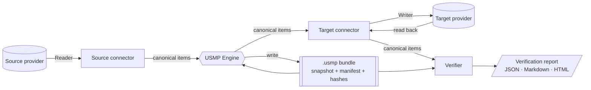

# USMP Architecture Overview (v3 draft)

> Status: **Draft for review** — part of the Phase 0 planning PR.
> Supersedes the OS-centric v2.0 design in `usmp_protocol_docs/` (to be moved to `docs/vision/v2/`).

## 1. What USMP is

USMP (Universal Service Migration Protocol) is an **open, vendor-neutral protocol plus a reference
implementation** for moving a user's data and service configuration from one provider/platform to
another **without losing it**.

Examples it must eventually cover:

| Domain | From → To (examples) |
|---|---|
| Calendar | Google Calendar → iCloud (iOS/macOS), Nextcloud/CalDAV (Linux), Outlook, `.ics` |
| Contacts / Tasks | Google → iCloud / CardDAV / Outlook |
| Desktop app settings | VS Code / editor / dotfiles on Windows → macOS → Linux |
| Media & streaming | Playlists and library metadata between streaming services |
| Vehicle profiles | Driver profile (seat, climate, nav favourites, media presets) between cars / OEMs |
| Cloud infrastructure | AWS ↔ Azure resources and object storage |

## 2. Design principles

1. **Platform independent core.** The engine knows *nothing* about Google, Apple, AWS, etc. All
   platform knowledge lives in connectors (plugins).
2. **Canonical model per domain.** Every domain has one versioned, language-neutral schema
   (JSON Schema). Connectors map *to* and *from* it — N connectors, not N² converters.
3. **Non-destructive by construction.** Source connectors are bound through a read-only
   interface; the engine has no code path that writes to a source.
4. **Nothing is silently lost.** Every field that cannot be mapped produces a `LossRecord`.
   Loss is reported *before* the migration (preview) and *after* (verification report).
5. **Verify, don't trust.** After import, the engine reads back from the target and compares
   content hashes against the source.
6. **Local-first.** Runs on the user's machine; data and credentials stay there. A self-hostable
   server reuses the same engine later.
7. **Simple to extend.** A new provider = one Python package implementing a small interface and
   passing the conformance test kit.

## 3. Core concepts



| Concept | Description |
|---|---|
| **Domain** | A service category with a canonical schema, e.g. `usmp.calendar/v1`. |
| **Canonical item** | One record (an event, a contact…) in the domain schema, wrapped in an **envelope**: `usmp_id`, `domain`, `schema_version`, `source_ref`, `content_hash`, `payload`, `extensions`. |
| **Connector** | Plugin for one provider. Declares a **capability manifest**: domains, `read`/`write` support, and which canonical fields it can read and write. |
| **Reader / Writer** | The two connector roles. A connector used as a source is only ever given to the engine as a `Reader`. |
| **Bundle (`.usmp`)** | Portable zip archive: `manifest.json`, `items.jsonl`, `raw/` (original provider payloads for lossless fallback), `losses.json`. It is both a **backup** and an **offline transfer format** (for example, when the old car and the new car are never online together). |
| **LossRecord** | `{item, field, reason, severity}`, produced when a field cannot be represented in the canonical model or in the target. |
| **Verification report** | Per item: `verified`, `verified_with_declared_loss`, `mismatch`, or `missing`. Includes overall counts and exits non-zero if anything was not verified. |

### Comparable fields

Verification compares only the fields that **the source can read ∩ the target can write ∩ the target can read back**.
Fields outside that intersection must already be listed as declared losses. A mismatch inside the
intersection is a real failure.

## 4. Migration pipeline

```
plan ──► export ──► normalize ──► validate ──► snapshot(bundle) ──► preview(losses, counts)
                                                                        │ user confirms
verify ◄── import ◄── transform(target capabilities) ◄─────────────────┘
  │
  └──► report
```

Each step is a pure function over canonical items plus connector calls, so steps can be tested in
isolation and the pipeline can later resume from checkpoints (Phase 3).

`usmp migrate --dry-run` runs everything except `import`.

## 5. Reference implementation layout (Python)

```
spec/                       # language-neutral — the protocol itself
  usmp-spec.md              # normative spec (RFC 2119 language)
  schemas/core/             # envelope, manifest, loss record, report, capability manifest
  schemas/domains/calendar/v1/
src/usmp/
  core/                     # models, bundle, engine, verify, report, errors
  sdk/                      # Reader/Writer protocols, base classes, registry (entry points)
  domains/calendar/         # canonical model + helpers (recurrence, tz)
  connectors/               # built-in connectors: ics, caldav, google
  testing/                  # conformance kit (pytest plugin) for connector authors
  cli/                      # `usmp` command + interactive wizard
tests/  unit/  integration/  conformance/
docs/   adr/  architecture/  guides/  plan/  vision/
```

Connectors are discovered through the Python entry-point group `usmp.connectors`, so third-party
connectors can be installed with `pip install usmp-connector-foo` with no changes to the core.

## 6. Security and privacy baseline

- Credentials are stored in the OS keychain through `keyring` (macOS Keychain, Windows Credential
  Manager, Secret Service on Linux). They are never written to bundles or logs.
- OAuth uses the installed-app/PKCE flow and requests the narrowest scopes. Read-only scopes are
  used for sources wherever the provider offers them.
- Bundles can optionally be encrypted (age/X25519) in Phase 3.
- Logs are redacted. No telemetry.

## 7. Known constraints (stated honestly)

- **Streaming:** DRM-protected content cannot be migrated. Only library metadata, playlists and
  preferences can, and only where the provider's API and terms allow it.
- **Vehicles:** most OEM in-car APIs are closed. USMP will define the canonical *driver profile*
  model and bundle format first. Connectors depend on OEM/partner access or Android Automotive.
- **Cloud infra:** this is resource translation, not byte copying. The planned approach is to read
  the source via SDKs and emit OpenTofu/Terraform for the target, plus a separate storage data mover.
