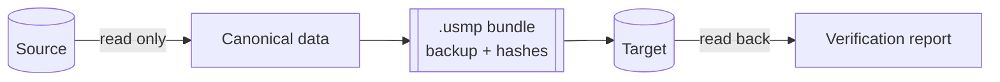

# USMP — Universal Service Migration Protocol

**Move your data between services and platforms without losing it.**

USMP is an open, vendor-neutral protocol and a reference implementation for migrating a user's data
and service configuration from one provider to another: Google Calendar to iCloud, AWS to Azure, one
car's driver profile to the next.

!!! note "Beta for calendars"
    Google Calendar, iCloud, Nextcloud, Fastmail, other CalDAV servers and `.ics` files work
    today. See the [roadmap](plan/ROADMAP.md).

## Quick start

```console
$ pipx install 'usmp-protocol[google]'
$ usmp migrate
```

With no options, `usmp migrate` asks where your calendar is now and where it should go, signs you
in, shows a preview of what will move (and anything that can't), then migrates and verifies
everything. It ends by printing the equivalent command so you can repeat it. Guides:
[Google](guides/google.md) · [CalDAV, iCloud and Nextcloud](guides/caldav.md).

## How it works



- **Platform-independent core.** Each provider is handled by a connector plugin.
- **One canonical model per domain**, published as versioned JSON Schema.
- **Your source is never modified.**
- **Nothing is lost silently.** Losses are listed before you migrate, and everything is verified afterwards.
- **Local-first.** Your data and credentials stay on your machine.

Start with the [architecture overview](architecture/overview.md).
